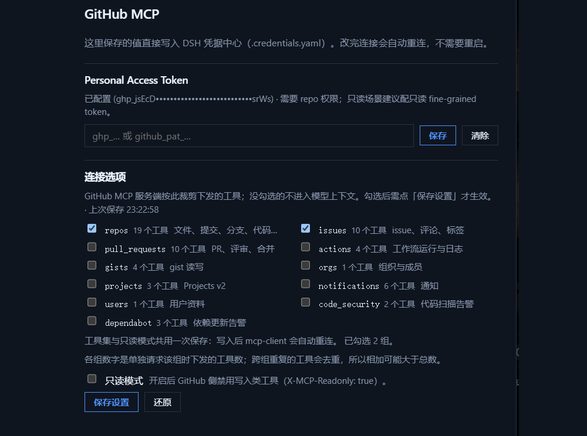

# dsh-github-mcp

Connect DSH to the **official GitHub MCP server**. The token, the toolset selection and the read-only switch all live in **Settings → GitHub MCP** and are stored in the DSH credential store, with automatic reconnects — no hand-editing `cordis.patch.yml`, no bridging the token into `process.env`, no restarts.




## What it fixes

0.2.0 shipped a hand-written YAML parser that read `~/.dsh/.credentials.yaml`, injected the token into `process.env.GITHUB_TOKEN`, and let a `!!js` expression in `cordis.patch.yml` turn it into a request header. That chain had three problems:

| | manual bridge (0.2.0) | this version (0.3.0) |
|---|---|---|
| where the token comes from | the plugin parses the YAML file itself | host `credentials` service via `${credential:GITHUB_TOKEN}` templates |
| after changing the token | restart DSH | written to the credential store, the connection reconnects |
| can the model see the plaintext | yes — `github_set_token` handed the PAT to the model | no — the settings form writes straight to the credential store |
| changing toolsets | edit the `X-MCP-Toolsets` string in the patch | tick boxes, press Save |
| diagnosing a failure | read logs, or guess | status line + `github_token_status` live probe |

Also corrected: the old README claimed "environment variables win and are read-only, `set` is rejected, changing the token needs a restart". None of that matches `dsh-credentials-local` — `resolve` prefers the file, and `set` has no env check and does call `notifyUpdated`.

## Install

**Requires** DSH desktop 0.2.2-rc.3+ (uses the `mcpManager` service and the `settings.section` slot).

### Option 1: npm (recommended)

```powershell
dsh plugin --profile desktop add dsh-github-mcp
```

Pin the version so a release does not upgrade you silently:

```powershell
dsh plugin --profile desktop add dsh-github-mcp@0.3.0 --save-exact
```

### Option 2: the Plugins page

1. DSH desktop → **Settings** (bottom left) → **Plugins**
2. **Add** (top right), then enter any of:
   - npm: `dsh-github-mcp`
   - GitHub: `github:ZIye1208/dsh-github-mcp`
   - local directory: `H:/path/to/dsh-github-mcp`
3. **Fully quit DSH and start it again** (plugins load at boot; hot reload does not apply)

> npm installs are pre-built; GitHub installs use the source, which is plain JS with no bundler step.

### Option 3: command line (equivalent)

```powershell
dsh plugin --profile desktop add dsh-github-mcp --save-exact
dsh plugin --profile desktop add github:ZIye1208/dsh-github-mcp
```

Then quit and restart DSH.

### Verify

```powershell
Select-String -Path "$env:USERPROFILE\.dsh\profiles\desktop\package.json" -Pattern "dsh-github-mcp"
```

Both `dependencies` and `dsh.profile.bundles` must list it — a package in `dependencies` only is not activated.

## Usage

Settings → **GitHub MCP** has three blocks:

### 1. Personal Access Token

- The input is `type=password`; it is cleared on submit and only a mask (`ghp_xxxxx••••wxyz`) is shown
- **Save** writes to the credential store; **Clear** removes it
- The status line reports the source: `configured (masked)` / `configured (env, read-only)` / `not configured`
- **Permissions**: a classic PAT needs `repo`; to let the model only read code, use a fine-grained PAT scoped to the repos you need and enable **read-only mode**

### 2. Connection options (toolsets)

The GitHub MCP server can trim its tool list per toolset. **Unchecked toolsets are never sent**, so they cost no context budget.

- Ticking only changes a draft; **Save settings** writes it
- After writing, the plugin reads back `configured === true`; a failed write raises an error instead of pretending to succeed
- The status line shows `✓ Saved · toolsets repos,issues · read-only off · 23:58:31`
- mcp-client listens for `credentials/reference-updated` and reconnects automatically

| Toolset | Tools | Covers |
|---|---|---|
| `repos` | 19 | files, commits, branches, code search |
| `issues` | 10 | issues, comments, labels |
| `pull_requests` | 10 | PRs, reviews, merges |
| `actions` | 4 | workflow runs and logs |
| `gists` | 4 | gists |
| `orgs` | 1 | organizations and members |
| `projects` | 3 | Projects v2 |
| `notifications` | 6 | notifications |
| `users` | 1 | user profiles |
| `code_security` | 2 | code scanning alerts |
| `dependabot` | 3 | dependency alerts |

> Measured on 2026-11-18 by requesting `api.githubcopilot.com/mcp/` once per toolset (`X-MCP-Toolsets` with a single value). The counts sum to 63 while the full server exposes 46, because some tools belong to several toolsets. `repos + issues = 29` equals the combined total, so those two do not overlap.

**`repos,issues` (29 tools) is the default.** Most of the remaining 46 are in `pull_requests`, `notifications` and `actions`.

### 3. Read-only mode

Sends `X-MCP-Readonly: true`, disabling write tools on the GitHub side. Good for "let the model read code, not change it".

> After changing toolsets/read-only, **open a new session** to see the new tool list — the tool surface is snapshotted when a session starts.

## How it works

```
settings UI (client.js)
   │  ctx.remote.credentials.set(ref, value)
   ▼
host credentials service ──write──▶ ~/.dsh/.credentials.yaml
   │                                refs: GITHUB_TOKEN / GITHUB_MCP_TOOLSETS / GITHUB_MCP_READONLY
   │  credentials/reference-updated
   ▼
dsh-mcp-client re-expands templates → reconnects
   │
   ▼
mcpManager.register("github", { ...headers are ${credential:REF} templates... })
   │
   ▼
29 mcp__github__* tools reach the model context
```

Two design points:

1. **Credential templates** come from `@deepseek-ai/dsh-mcp-client` (`${credential:NAME}`); the host expands them at connect time, so the plugin never holds the plaintext.
2. **The connection goes through `mcpManager`**, not through a hand-inserted `@deepseek-ai/dsh-mcp-client` row in the patch. The latter hangs on `tools/list` on 0.2.2 with no visible status; `mcpManager` grants a 30 s startup budget and publishes the connection status through `manager.list()`.

`cordis.patch.yml` is therefore a single insert:

```yaml
- insert:
    - id: dsh-github-mcp
      name: 'dsh-github-mcp'
```

## Security model

| Question | Answer |
|---|---|
| Where is the token stored | `~/.dsh/.credentials.yaml`, mode `0600` (directory `0700`). **The file is plaintext YAML; DSH does not encrypt it** |
| Who can read it | Any local program running as your user. That is inherent to local credentials; the plugin does not pretend otherwise |
| Can the model see the token | No. The form writes straight to the credential store; `github_token_status` only reads the masked `describe()` output |
| Does it reach logs | Expanded template values are added to the host redaction list; plugin logs print ref names, never values |
| Network destinations | `https://api.githubcopilot.com/mcp/` (GitHub's MCP) and `https://api.github.com/user` (only when you run `github_token_status`) |

`GITHUB_MCP_TOOLSETS` / `GITHUB_MCP_READONLY` share the same file only because "credential change → reconnect" is the working path; their values are `repos,issues` and `false`, not secrets.

## Compatibility

- DSH `0.2.2-rc.3` (desktop) tested; requires the host `mcpManager` and `credentials` services
- Tool names are stable as `mcp__github__<raw_name>`, so allow-lists and tool governance keep matching
- `dsh-github-mcp-hint` is now an `optionalDependencies` entry; the plugin works without it

## Development

No build step: `lib/client.js` is a hand-written `__ModuleLoader__` factory, `lib/index.mjs` is plain ESM.

```powershell
node --check lib/client.js
node test/config.test.mjs
node test/host.test.mjs
node test/client.test.mjs
node test/client.render.test.mjs
node test/patch.test.mjs
```

## License

MIT
