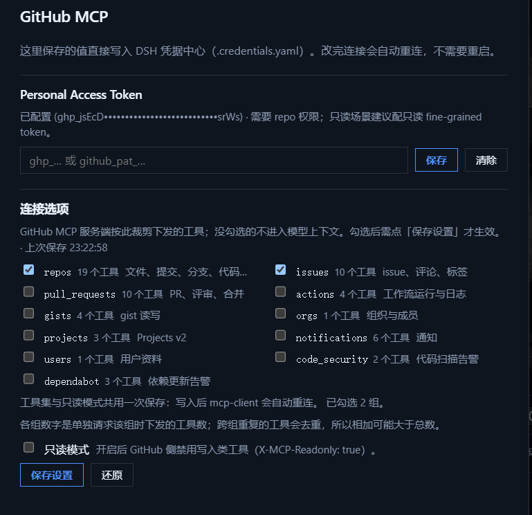

# dsh-github-mcp

给 DSH 接入 **GitHub 官方 MCP 服务器**。token、工具集、只读开关都在「设置 → GitHub MCP」里改，值存进 DSH 凭据中心，改完自动重连——不用手改 `cordis.patch.yml`，不用把 token 桥进 `process.env`，不用重启。




## 它解决的问题

上游 0.2.0 的做法是：插件在启动时手写一份 YAML 解析器去读 `~/.dsh/.credentials.yaml`，把 token 塞进 `process.env.GITHUB_TOKEN`，再由 `cordis.patch.yml` 里的 `!!js` 表达式展开成请求头。这条链有三个硬伤：

| | 手工桥接（0.2.0） | 本版本（0.3.1） |
|---|---|---|
| token 从哪来 | 插件自己 parse YAML 文件 | 宿主 `credentials` 服务的 `${credential:GITHUB_TOKEN}` 模板 |
| 改 token 后 | 必须重启 DSH | 写进凭据中心，连接自动重连 |
| 模型能看到明文吗 | 能——`github_set_token` 让模型经手 PAT | 不能——设置页输入框直写凭据中心，模型侧只有一个只读状态工具 |
| 工具集怎么调 | 手改 patch 里的 `X-MCP-Toolsets` 字符串 | 设置页勾选，保存即生效 |
| 出问题怎么查 | 看日志，或者猜 | 设置页显示状态 + `github_token_status` 做活体探测（可选） |

顺带修掉的问题：原版 README 声称「环境变量优先且只读、`set` 会被拒、改 token 必须重启」——这三条与 `dsh-credentials-local` 的实际实现都不符（`resolve` 是文件优先，`set` 无 env 检查且会 `notifyUpdated`）。

## 安装

**前置**：DSH 桌面端 0.2.2-rc.3 及以上（用到 `mcpManager` 服务与 `settings.section` 席位）。

### 方式一：npm（推荐）

```powershell
dsh plugin --profile desktop add dsh-github-mcp
```

钉住版本（推荐，发新版不会意外升级）：

```powershell
dsh plugin --profile desktop add dsh-github-mcp@0.3.1 --save-exact
```

### 方式二：插件页添加（不用记命令）

1. DSH 桌面端 → 左下角**设置** → **插件**
2. 右上角**添加**，填下面任意一种标识：
   - npm：`dsh-github-mcp`
   - GitHub：`github:ZIye1208/dsh-github-mcp`
   - 本地目录：`H:/path/to/dsh-github-mcp`
3. 安装完成后**完全退出 DSH 再打开**（插件在启动时加载，热重载不生效）

> 从 npm 装的包是预构建产物，不需要跑构建脚本；从 GitHub 装走源码，同样是纯 JS，没有打包步骤。

### 方式三：命令行（与上面等价）

```powershell
# 从 npm
dsh plugin --profile desktop add dsh-github-mcp --save-exact

# 从本地目录（开发时改完源码立刻生效，桌面端装的是链接不是拷贝）
dsh plugin --profile desktop add H:/path/to/dsh-github-mcp

# 从 GitHub
dsh plugin --profile desktop add github:ZIye1208/dsh-github-mcp
```

装完同样要**完全退出 DSH 再打开**。

### 验证装上了

```powershell
Select-String -Path "$env:USERPROFILE\.dsh\profiles\desktop\package.json" -Pattern "dsh-github-mcp"
```

`dependencies` 和 `dsh.profile.bundles` 两处都要出现——只进 `dependencies` 不进 `bundles` 的话插件不会激活。

## 用法

设置 → **GitHub MCP**，三块：

### 1. Personal Access Token

- 输入框是 `type=password`，提交后立刻清空，页面只回显掩码（`ghp_xxxxx••••wxyz`）
- 「保存」写入凭据中心；「清除」删除该凭据
- 状态行会告诉你来源：`已配置（掩码）` / `已配置（环境变量，只读）` / `未配置`
- **token 权限**：classic PAT 勾 `repo`；只想让 model 读代码的话，用 fine-grained PAT 并只授你需要的仓库读权限，同时把「只读模式」打开

### 2. 连接选项（工具集）

GitHub 的 MCP 服务器支持按 toolset 裁剪下发的工具。**没勾选的组根本不会下发**，不占模型的上下文预算。

- 勾选只改草稿，点「保存设置」才真正写入
- 保存后会回读确认 `configured === true`，写不进去会直接报错，不会假装成功
- 状态行显示 `✓ 已保存 · 工具集 repos,issues · 只读 关 · 23:58:31`
- 写入后 mcp-client 监听 `credentials/reference-updated` 自动重连

| 工具集 | 工具数 | 覆盖 |
|---|---|---|
| `repos` | 19 | 文件、提交、分支、代码搜索 |
| `issues` | 10 | issue、评论、标签 |
| `pull_requests` | 10 | PR、评审、合并 |
| `actions` | 4 | 工作流运行与日志 |
| `gists` | 4 | gist 读写 |
| `orgs` | 1 | 组织与成员 |
| `projects` | 3 | Projects v2 |
| `notifications` | 6 | 通知 |
| `users` | 1 | 用户资料 |
| `code_security` | 2 | 代码扫描告警 |
| `dependabot` | 3 | 依赖更新告警 |

> 数字是 2026-11-18 对 `api.githubcopilot.com/mcp/` 逐组单独请求（`X-MCP-Toolsets` 只带一个值）实测的。各组相加（63）大于全量（46），因为部分工具同时属于多个 toolset；`repos + issues = 29` 正好等于这两组组合后的总数，说明这两组不重叠。

**默认只勾 `repos,issues`（29 个工具）**。全量 46 个里剩下的多在 `pull_requests`、`notifications`、`actions`。

### 3. 只读模式

打开后请求带 `X-MCP-Readonly: true`，GitHub 侧禁用写入类工具。适合「只让模型看代码，不让它改东西」的场景。

> 改了工具集/只读之后，已经开着的会话要**新开一个**才能看到新的工具清单（工具面在会话建立时快照）。

## 工作原理

```
设置页 (client.js)
   │  ctx.remote.credentials.set(ref, value)
   ▼
宿主 credentials 服务  ──写──▶  ~/.dsh/.credentials.yaml
   │                          refs: GITHUB_TOKEN / GITHUB_MCP_TOOLSETS / GITHUB_MCP_READONLY
   │  credentials/reference-updated 事件
   ▼
dsh-mcp-client 重新展开模板 → 重连
   │
   ▼
mcpManager.register("github", { ...headers 里是 ${credential:REF} 模板... })
   │
   ▼
29 个 mcp__github__* 工具进入模型上下文
```

两个关键点：

1. **凭据模板**由 `@deepseek-ai/dsh-mcp-client` 提供（`${credential:NAME}`），宿主在连接时展开，插件自己碰不到明文。
2. **连接交给 `mcpManager`**，而不是在 patch 里直接手插一个 `@deepseek-ai/dsh-mcp-client` 行。后者在 0.2.2 上会挂在 `tools/list` 上且状态不可见；`mcpManager` 给 30 秒启动预算，并把连接状态发布到 `manager.list()`，出问题能看见。

`cordis.patch.yml` 因此只用了一行：

```yaml
- insert:
    - id: dsh-github-mcp
      name: 'dsh-github-mcp'
```

## 安全模型

| 问题 | 答案 |
|---|---|
| token 存在哪 | `~/.dsh/.credentials.yaml`，权限 `0600`（目录 `0700`）。**磁盘上是明文 YAML，DSH 不加密它** |
| 谁能读到 | 同机的、以你用户身份运行的程序都能读。这是本地凭据的固有限制，插件不假装能挡住 |
| 模型能看到 token 吗 | 不能。设置页输入框直接写凭据中心，`github_token_status` 只读 `describe()` 的掩码/来源，不 `resolve()` |
| 日志里会有 token 吗 | 模板展开的值由宿主加入 redact 列表；插件自己的日志只打 ref 名，不打值 |
| 会外联到哪 | 只有 `https://api.githubcopilot.com/mcp/`（GitHub 官方 MCP）和 `https://api.github.com/user`（只在你跑 `github_token_status` 时探活） |

`GITHUB_MCP_TOOLSETS` / `GITHUB_MCP_READONLY` 也放在同一个文件里，纯粹是因为「凭据变更会触发重连」这条链路现成可用；它们的值是 `repos,issues` 和 `false`，不是密钥。

## 兼容性

- DSH `0.2.2-rc.3`（桌面端）实测可用；要求宿主暴露 `mcpManager` 与 `credentials` 服务
- 工具名稳定为 `mcp__github__<raw_name>`，白名单/工具治理规则按这个名字匹配
- `dsh-github-mcp-hint`（可选面板插件）降为 `optionalDependencies`，没装不影响主功能

## 开发

无构建步骤：`lib/client.js` 是手写的 `__ModuleLoader__` 工厂，`lib/index.mjs` 是纯 ESM。

```powershell
node --check lib/client.js
node test/config.test.mjs
node test/host.test.mjs
node test/client.test.mjs
node test/client.render.test.mjs
node test/patch.test.mjs
```

| 测试 | 跑什么 |
|---|---|
| `test/config.test.mjs` | 工具集解析、去空去重保序、草稿比较 |
| `test/host.test.mjs` | `seedCredentialDefaults` 只补缺省不覆盖；`mcpManager` 不可用时降级 |
| `test/client.test.mjs` | 模块加载契约：`inject` 声明、slot 注册 |
| `test/client.render.test.mjs` | 假 React 渲染整屏：工具数文案、按钮、掩码回显 |
| `test/patch.test.mjs` | patch 只有一行 insert，且不含 `!!js` / `process.env` |

`test/*.test.mjs` 里的 host/patch 用例会把 `@deepseek-ai/*` 解析到本地 DSH 安装目录（`DSH_NODE_MODULES` 可覆盖），没有 DSH 时自动跳过。

## License

MIT
